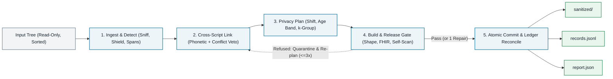
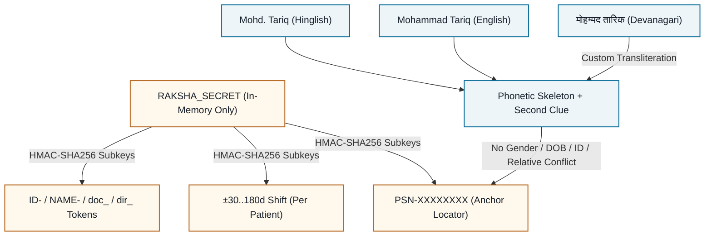

# Project Umbrella

**Offline, CPU-only, model-free privacy firewall for multilingual Indian hospital records (English, हिंदी & Hinglish).**  
Built for **Track 3 — Secret Wards** by **Team JenSON**: Siddhesh Goel *(Leader)*, Krishna Bhatia, and Nithin Jagganatham.

`Python 3.10+` · `Standard Library Only` · `Zero LLMs / Models` · `Offline CPU` · `Deterministic HMAC-SHA256` · [`2-Page Project Brief (PDF)`](docs/brief.pdf)

---

Umbrella ingests chaotic, multi-hospital exports (`CSV`, `TSV`, nested `JSON`, `FHIR R4`, and free-text clinical notes across UTF-8, UTF-16, and legacy `cp1252`), strips personal identifiers across scripts and hidden channels, preserves clinical facts intact, links each patient under one secret-keyed pseudonym (`PSN-XXXXXXXX`), applies one consistent quasi-identifier plan everywhere, and verifies every output file through an in-memory **release gate** before a single byte hits disk.

## Scorecard at a Glance

| Benchmark (`dev/input` & multi-seed chaos suite) | Result |
|---|---:|
| **Personal data leaked** (`check_dev.py`: Latin / Devanagari / Hinglish across all 6 channels) | **0.0%** *(0 / 3,230)* |
| **Planted canaries leaked** · **Broken / unsupported files copied raw** | **0 / 4** · **0** |
| **Medical values preserved** (doses, vitals, labs, diagnoses, procedures, stay lengths) | **99.2%** *(4,815 / 4,855)* |
| **Patient linking** — Precision / Recall / **F0.5** *(wrong merges)* | **1.00 / 0.98 / 1.00** *(0)* |
| **Unseen-format chaos test** (5 seeds: new names, IDs, prefixes, headers, keys, labels, dates) | **0.0% leaked** · **0 / 8 canaries** |
| **Pooled attacker re-identification** (`attacker_lite.py`: raw data **98%**) | **23%** |
| **Record-linkage attack** (raw **92%**) · **Pseudonym inversion / cross-secret stability** | **5%** · **0% / 0%** |
| **Speed & memory** (`200` files, `815` records) · **Linear scaling exponent** (`16×` load) | **1.4 s / 49 MB** · **0.98–0.99** |

---

## Quickstart

```bash
# 1. Setup (standard library only; dev tools in requirements-dev.txt)
pip install -r requirements.txt

# 2. Sanitize a hospital export directory (offline; RAKSHA_SECRET required)
RAKSHA_SECRET=<secret> python3 main.py --input <input_dir> --output <empty_output_dir>

# 3. Run full test, determinism, chaos-leak, attacker, scaling & submission suite
bash tools/verify.sh --submit --scale
```

### Output Contract

```text
<output_dir>/
├── sanitized/       Cleaned mirror of input tree; PII-bearing paths renamed to doc_<HMAC> / dir_<HMAC>
├── records.jsonl    One {"file", "loc", "patient"} line per exported record (row:N | /json/ptr | doc)
└── report.json      SHA-256 manifest of every input file, status/quarantine reason, entity totals & RSS
```

---

## System Architecture

Stages **only mark character spans**; a single span writer (`src/rewrite/spans.py`) resolves overlaps and mutates text, and a single file ledger (`src/core/ledger.py`) decides every file's fate.



### Keyed Cryptography & Cross-Script Identity Flow



---

## Project Structure

```text
Project-Umbrella-/
├── main.py                  CLI entry point (validates RAKSHA_SECRET, invokes safety shell)
├── raksha.toml              Evaluator build & offline run specification
├── config/
│   ├── policy.yaml          Declarative privacy policy (bands, shifts, k=5, rarity, budget)
│   └── lexicons/            Indian names, clinical/drug/eponym terms, Hindi grammar, UP & India districts
├── docs/
│   ├── brief.html           Source for the 2-page Project Brief (rebuilt via tools/build_brief.sh)
│   └── brief.pdf            Submitted 2-page Project Brief PDF
├── src/
│   ├── pipeline.py          Orchestrates Passes 1–5, dirty-path mapping, re-plan loop & watchdog
│   ├── core/                Data models (__slots__ Span), file ledger, HMAC subkeys, zero-PII logger
│   ├── ingest/              Magic-byte sniffing, strict encoding cascade, table/FHIR & iterative JSON parsers
│   ├── detect/              Scorer-parity normalizer, ID/name/address rules, profiler, clinical shield, hidden channels
│   ├── link/                Devanagari transliterator, phonetic keys, compound blocking, PSN placement
│   ├── privacy/             QI mentions, per-patient shifts/bands/escalation, ICD-10 chapter generaliser
│   ├── rewrite/             Single overlap-resolving span writer & format-preserving file builders
│   └── release/             In-memory UTF-8/CSV/JSON/FHIR validator, normalized self-leak scanner & repair
├── tools/
│   ├── verify.sh            End-to-end gate: pytest, 3-run contract, chaos mutator, attacker, scaling & submit check
│   ├── attacker_lite.py     Published voter-list & longitudinal re-identification attacker (A1–A7)
│   ├── chaos_mutator.py     Scrambles names, scripts, IDs, headers, keys, base64 & dates to test unseen formats
│   ├── leak_check.py        Scorer-equivalent normalized & base64-decoded leak counter
│   └── scale_check.py       Runtime & RSS growth-exponent profiler up to 144k records
└── tests/                   358 unit & regression tests across every module and trap category
```

---

## How Each Layer Works

### 1. Ingestion & Structural Integrity (`src/ingest/`)
- **Content over extension:** Format is sniffed from bytes (`JSON` inside `.csv` is parsed as JSON; strict multi-column tables inside `.txt` are parsed as tables; `PDF`, images, archives, and `XML` are quarantined as `unsupported_format`).
- **Fail-closed encodings:** Tried in strict order — `UTF-8 BOM` → `UTF-16` → strict `UTF-8` → genuine `cp1252`. Stray surrogates, mixed encodings, or replacement bytes quarantine the file as `invalid_encoding` so corrupted text can never hide a name.
- **Arbitrary JSON depth & ragged tables:** Standard JSON parsing falls back to an iterative parser, walker, and serializer (`1,500+` levels deep without recursion). Record lists are discovered up to 3 levels deep. CSV/TSV delimiters (`,`, `\t`, `;`, `|`), quotes, BOMs, and shifted rows (flagged for full-cell scanning) are preserved.

### 2. Multilingual Detection & Hidden Channels (`src/detect/`)

| Surface | How Umbrella Handles It |
|---|---|
| **Indian Identifiers** | Aadhaar (any separator, masked), ABHA numbers & `@abdm` addresses, PAN, emails, insurance IDs, and phones (`+91`, `0`-prefixed, brackets, 5-5, 3-3-4, landlines, masked `•`, Devanagari & Arabic-Indic digits). Hospital MRNs/UHIDs are caught **by shape** (letter prefix + ≥ 5 digits across segments) → keyed `ID-XXXXXXXX` tokens (`0` when stored as a JSON number). Package/ICD/LOINC codes, doses, and vitals are untouched. |
| **Value-Driven Profiler** | Classifies CSV columns and JSON paths primarily from cell values, using English/Hindi/Hinglish keys only as hints (`guardian.name` → relative; name column beside bare `S/o`/`W/o` column → relative; unclassified columns scanned as free text). |
| **Context Names (3 Scripts)** | Captures labelled names (`Name:`, `मरीज़ का नाम:`, `Rogi ka naam:`), surname-first (`Sharma, Ravi`), compact initials (`R.K. Verma`), slash-terminated (`Ram Kumar/45/M`), relatives (`S/o`, `W/o`, `पुत्र`, `पत्नी`), fragmented leads (`Asha, W/o Kamal`), honorifics (`ji`, `sahab`, `जी`, `श्रीमती`), Hindi/Hinglish postpositions (`ka/ki/ke/ne/ko/se`), attendants, timelines, and chat headers. Confident names spread case-insensitively **within the same file only**. |
| **Addresses & FHIR R4** | Strips house numbers (`H.No. 364`, `मकान नं. 398`), localities (`Mohalla`, `Colony`, `Nagar`, municipal `Ward`), landmarks (`near Pani Tanki`, `मस्जिद के पीछे`), and villages (`[VILLAGE]` in prose; tehsil in fields). PINs keep 3 digits (`229***`). Cleans FHIR `Patient`/`RelatedPerson`, `subject.display`, unlabelled `address.line`, and person extensions while keeping `Practitioner` and `Organization`. |
| **Hidden Leakage Channels** | Runs detectors over a **scorer-parity normalized view** (HTML entities, `%XX`, `\uXXXX`, zero-width chars, Cyrillic/Greek homoglyphs, Latin diacritics, NFKC) mapped back to exact raw offsets. Recursively cleans readable `base64` (standard, URL-safe, MIME, `data:`) and `hex` payloads (binary attachments → encoded `[ATTACHMENT REMOVED]`). Cleans CSV headers, JSON keys (`ID-` / `NAME-`), path digit cores, and PII filenames/folders (`doc_<HMAC>` / `dir_<HMAC>`). |

### 3. The Clinical Shield (`src/detect/shield.py`)
Shield spans block name/address false positives while allowing direct-identifier patterns (e.g., a phone number inside a doctor string) to still redact:

| Protected Clinical Construct | Examples Kept Intact |
|---|---|
| **Doctors & Staff** *(including shared first names)* | `Dr. Ramesh Srivastava (MD Medicine)`, `डॉ. रमेश`, FHIR `Practitioner.name` |
| **Doses, Frequencies & Durations** | `Ramipril 5 mg`, `Dolo 650 BD x 5 days`, `1-0-1`, `100 mg + 0.5 mg`, `6 दिन से` |
| **Complaints vs. Care-Of (`C/O`) & History** | Keeps `C/O pain abdomen x 6 days`, `K/C/O DM2`, `H/O TB`; strips person after `C/O Naresh` or `, S/o …` |
| **Clinical Wards, Eponyms, Roles & Lexicons** | `Ward 8 (Medicine)`, `Bed 29`, `Addison's disease`, `Foley catheter`, `ASHA worker` *(vs. patient `Asha`)*, hospitals/labs, `HbA1c`, `SG039B`, UP & all-India districts |

### 4. Conservative Cross-Script Record Linkage (`src/link/`)
- **Script-independent matching:** Custom Devanagari-to-Latin transliteration (schwa deletion, anusvara, nukta) + phonetic consonant skeletons equate *मोहम्मद तारिक*, *Mohammad Tariq*, and *Mohd. Tariq* while keeping *Rina* ≠ *Rani*. Generic tokens (`Mohd.`, `Kumar`, `Devi`, `Singh`) never link alone.
- **Linear-time blocking & hard vetoes:** Compound blocking on `(name_skeleton, dob | relative | village)` plus clue-signature deduplication avoids dropping common surnames while scaling linearly. Links require a strong ID, a non-household phone/insurance ID, or name + second clue. **Zero-false-merge vetoes** reject any conflict on gender, Aadhaar/ABHA, same-role relative, name, or DOB/birth year; multi-patient index sheets stay unlinked (`patient: null`).
- **Consistent placement:** `PSN-XXXXXXXX` replaces the patient's record-number field, FHIR `Patient.identifier`, or fallback patient-name spans (`100%` agreement between `sanitized/` and `records.jsonl`).

### 5. Per-Patient Privacy Plan (`src/privacy/`, `config/policy.yaml`)
- **Uniform date shift & withheld DOB:** One keyed `±30..180` day shift per patient preserves every admission-to-discharge stay and follow-up interval (day-first vs. month-first inferred per file/hospital source; `Mon DD, YYYY`, numeric, and ISO formats preserved). **DOBs are withheld** (`[DOB]`; FHIR `_birthDate` `data-absent-reason: masked`) because a shifted DOB still leaks birth year (**69% → 23%** pooled re-identification).
- **Truthful age bands & k-escalation:** One band per patient (`10`-year, escalating to `20`-year with `5`/`10`-year boundary offsets when recorded ages straddle a decade; clamped at `0`, top-coded at `90+`). Villages generalise to tehsil; groups below `k = 5` on `(gender, age_band, place)` escalate to district, then `20`-year bands.
- **High-risk & rare-condition protection:** Cohort-scaled rarity cap (`1` patient for cohorts ≤ 80, `2` for ≤ 160, `3` above 160) generalises rare diagnoses (codes + free text) to their **ICD-10 chapter**, withholds rare procedures, and jitters discharge dates by `+1` day for high-risk profiles (rare diagnosis/procedure, stay length ≤ 3 patients, or age ≤ 5 / ≥ 85).

### 6. In-Memory Release Gate (`src/release/`)
Before disk commit, every rendered file must pass:
1. **Structural & FHIR R4 checks:** Valid UTF-8, identical CSV row/cell shape, identical JSON keys/value types (allowing age-band strings and FHIR `_field` extensions), identical text line count, and valid FHIR resource types, internal references, dates, and base64 attachments.
2. **Self-attack leak scan:** Re-reads output with scorer normalization, base64/hex decoding, and separator-stripped Indic/ASCII digits. Leftover PII gets **one safe repair pass**; if any check still fails, the file is quarantined (`leak_check_failed` / `format_check_failed`) and Passes 2–4 re-run without it (≤ 3 rounds).

---

## Attack Resistance, Unseen Formats & Scaling

### Published Attacker Simulation (`tools/attacker_lite.py`)

| Attack Vector | Raw Data | Umbrella | Notes |
|---|---:|---:|---|
| **A1** — Direct identifier exposure | 100% | **0%** | Zero names, phones, emails, IDs, or canaries survive |
| **A2 / A3** — Voter-list record linkage | 92% | **5%** | Posterior probability mass on the true person |
| **A4** — Longitudinal profile pooling | 98% | **23%** | Driven down from 69% by withholding DOB & consistent shifts |
| **A5** — Targeted visit-fact attack | 100% | **58%** | Common diagnoses are deliberately kept for clinical utility |
| **A6 / A7** — Pseudonym inversion / cross-secret link | — | **0% / 0%** | Keyed HMAC over anchor locator; rotates under new secret |

### Unseen-Format Chaos Suite & Linear Runtime Scaling
- **Zero practice-data tuning (`tools/chaos_mutator.py`):** Replaces every name with invented Latin & Devanagari tokens absent from our lexicons, mutates phone/Aadhaar/ID formats & hospital prefixes, rewrites CSV headers, JSON keys, and Hindi/Hinglish labels, and scrambles date formats (`truth.json` read-only; leak checker calibrated on raw scrambled input first). Across **5 independent seeds** (`809–840` injected PII values each): **0.0% leaked** and **0 / 8 canaries**.

| Workload (`tools/scale_check.py`, Apple M-series, 1 core) | Records | Time | Peak RSS |
|---|---:|---:|---:|
| Practice dataset (`200` mixed files) | 815 | **1.4 s** | **49 MB** |
| `16×` scrambled copies | 13,049 | **22 s** | **331 MB** |
| `32×` scrambled copies | 26,107 | **44 s** | **540 MB** |
| Single `4 MB` CSV register | 32,000 | **45 s** | **647 MB** |
| Single `25 MB` JSON bulk export | 144,000 | **104 s** | **1.6 GB** |

---

## Security, Models & Limitations

> [!IMPORTANT]
> **Models Declaration:** **None.** Umbrella uses zero LLMs, zero generative models, and zero pretrained transformers or ML weights — only deterministic rules, curated gazetteers, custom transliteration/phonetic matching, and keyed `HMAC-SHA256`.

- **Zero side-channel leakage:** `RAKSHA_SECRET` never leaves memory and derives domain-separated subkeys. Logs emit event codes and integer counts only; exceptions log class names only; warnings are silenced; `input/`, `TMPDIR`, and `HOME` remain untouched; `720 s` watchdog guarantees clean termination and ledger-to-disk reconciliation.
- **Known limitations:**
  1. *Rule-based ceiling:* An unlabelled name absent from all context cues and word lists in an unseen layout could slip past Pass 1 (mitigated by column profiling and the release gate).
  2. *Targeted attack (58%):* Common diagnoses are intentionally preserved for research utility; our local attacker is also simpler than the official evaluator on A2/A3 and A5.
  3. *Small-cohort `k = 5`:* On 57 patients, district + 20-year bands still leave small groups; rare-diagnosis/procedure/LOS rules protect outliers instead.
  4. *Quarantined binaries & large single files:* `PDF`, images, and `XML` are quarantined rather than OCR/parsed; a single `25 MB` JSON file peaks at `1.6 GB` RSS because all records link in memory; ambiguous dates (`03/04`) fall back to day-first when neither file nor hospital source disambiguates; withheld DOBs trade exact age-at-visit for strong re-identification defence.
